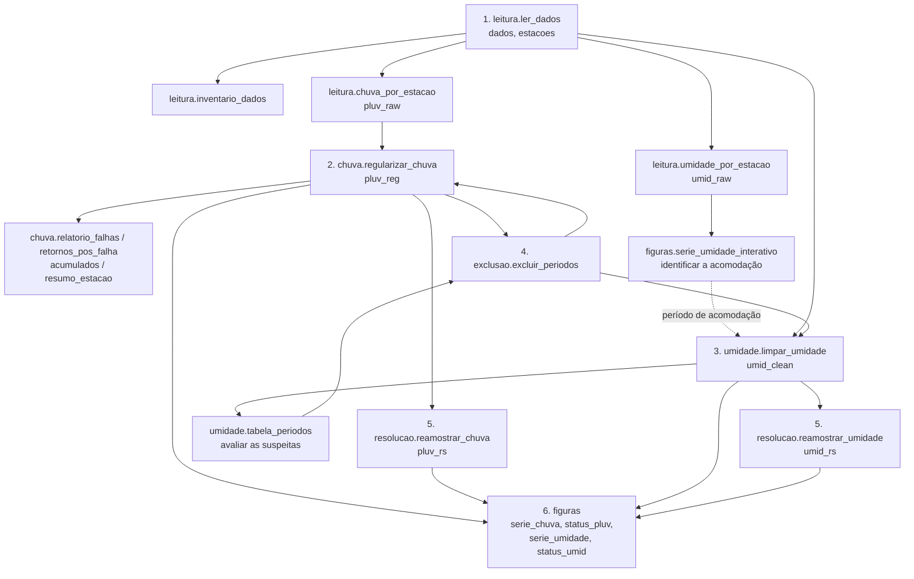

# pluvigeo: chuva e umidade do solo das PCDs do Cemaden

> **Em desenvolvimento (versão 0.x).** A biblioteca já é usada no Projeto SALAD, mas os nomes de
> funções e parâmetros ainda podem mudar entre versões. As mudanças ficam no [`CHANGELOG.md`](CHANGELOG.md).

Biblioteca do laboratório GRAPHID (Universidade Federal Fluminense), desenvolvida no Projeto SALAD,
para explorar e processar dados de chuva e umidade do solo baixados do Cemaden, vindos da
Plataforma de Entrega de Dados (PED) ou do mapa interativo. É um trabalho independente, **sem vínculo
com o Cemaden**.

Ela faz três coisas:

1. **Diagnóstico de integridade** da chuva e da umidade do solo, por regras automáticas com parâmetros;
2. **Ajuste da resolução temporal** (10 min → 1 h → 1 dia → mês), sem esconder as falhas;
3. **Plotagem** (matplotlib; as figuras de sufixo `_interativo` usam plotly).

## Instalação (Anaconda)

Abra o **Anaconda Prompt**, ative o ambiente que você usa nos notebooks e instale a partir da pasta
`pluvigeo` (a que contém o `pyproject.toml`):

```bash
conda activate base
```

```bash
cd "C:\caminho\ate\Produtos SALAD\pluvigeo"
```

```bash
pip install -e .
```

O `-e` instala em modo editável: a biblioteca continua nesta pasta e qualquer alteração no código
vale na hora, sem reinstalar. Depois disso `from pluvigeo import leitura` funciona em qualquer
notebook desse ambiente, e o editor passa a mostrar a descrição e os parâmetros de cada função
(no VS Code, selecione como kernel o mesmo ambiente em que instalou). O plotly (figuras interativas)
é instalado junto. Para rodar o notebook de exemplo, instale também o ipykernel e o nbformat (sem o
nbformat, o plotly não mostra as figuras interativas no notebook), e para rodar os
testes, o pytest:

```bash
pip install -e ".[notebook,teste]"
```

Para conferir a instalação: `python -m pytest testes -q`.

Requisitos: Python ≥ 3.10; pandas, numpy, matplotlib e plotly, instalados automaticamente se faltarem.

## Dados de entrada

A pluvigeo não baixa dados: ela lê os arquivos CSV que você baixou do Cemaden, em qualquer dos dois
formatos, compactados (`.csv.gz`) ou não.

- **PED (Plataforma de Entrega de Dados)**: https://ped.cemaden.gov.br. Exige cadastro; entrega um
  arquivo por estação, com todos os sensores (chuva e, nas PCDs Geo, umidade do solo).
- **Mapa interativo**: https://mapainterativo.cemaden.gov.br. Entrega um arquivo por mês com todas
  as estações de um município, só com a chuva.

Os horários vêm em UTC. O notebook de exemplo usa um recorte de dados reais de Petrópolis (RJ),
em [`exemplos/dados/`](exemplos/dados/LEIAME.md), com o crédito ao Cemaden.

## Começo rápido

```python
from pluvigeo import leitura, chuva, umidade, exclusao, resolucao, figuras

# 1. ler: arquivo, pasta ou lista; PED e mapa interativo dão a mesma tabela
dados, estacoes, n_dup = leitura.ler_dados('pasta_com_os_csv')

# 2. chuva: grade regular de 10 min com as falhas marcadas, todas as estações de uma vez
pluv_raw = leitura.chuva_por_estacao(dados)               # {codestacao: série bruta}
pluv_reg = chuva.regularizar_chuva(pluv_raw)              # {codestacao: tabela regular}
pluv_reg['330390605G']['chuva_mm']                        # a série a usar: 0 nos vazios curtos, NaN nas falhas
chuva.relatorio_falhas(pluv_reg)                          # uma linha por estação

# 3. umidade (PCDs Geo): limpeza por regras, direto da tabela lida, uma estação por vez
umid_clean = {}
umid_clean['330390605G'] = umidade.limpar_umidade(dados, '330390605G', acomodacao=('2021-11-01', '2022-07-31'))
umidade.tabela_periodos(umid_clean['330390605G'])         # o que foi excluído e o que só foi sinalizado

# 4. exclusão manual do que você julgou espúrio (a mesma função para chuva e umidade)
umid_clean['330390605G'] = exclusao.excluir_periodos(umid_clean['330390605G'], [('2023-09-18 17:00', '2023-09-18 17:00', ['n1'])])

# 5. outra resolução temporal (rs = resample)
pluv_rs = {cod: resolucao.reamostrar_chuva(reg, '1D') for cod, reg in pluv_reg.items()}   # dia civil
umid_rs = {cod: resolucao.reamostrar_umidade(r.operacional, '1h') for cod, r in umid_clean.items()}

# 6. figuras
fig = figuras.serie_chuva(pluv_reg['330390605G'], '2022-02-14', '2022-02-17')
figuras.salvar(fig, 'saida/chuva.png')
```

O passo a passo completo, com figuras, está no notebook
[`exemplos/exemplo_uso_pluvigeo.ipynb`](exemplos/exemplo_uso_pluvigeo.ipynb). As entradas e saídas de
cada função, com tipos e formatos, estão em [`docs/funcoes.md`](docs/funcoes.md).

## Os nomes dos objetos

O notebook e a documentação usam nomes que dizem a variável e a etapa do processamento:

- prefixo `pluv` (chuva) ou `umid` (umidade);
- sufixo `raw` (como foi lido), `reg` (chuva em grade regular, com as falhas marcadas), `clean`
  (umidade limpa) ou `rs` (*resample*: reamostrado para outra resolução);
- cada objeto é um dicionário `{codestacao: dado}`; `pluv_reg['330390605G']` é uma estação.

As estações são identificadas sempre pelo código completo (ex.: `330390605G`), que não se repete
entre municípios e estados.

## Fluxo de uso

A leitura alimenta dois ramos independentes: chuva e umidade. A limpeza da umidade parte direto da
tabela lida e busca sozinha a chuva da própria estação (para a regra do pico sem chuva); por isso
não depende de nenhum passo do ramo da chuva.



Em palavras:

1. **Ler** tudo com `ler_dados`; conferir com `inventario_dados`.
2. **Chuva:** separar por estação (`chuva_por_estacao`) e regularizar (`regularizar_chuva`). A
   tabela regular é a base de todo o resto: relatórios e resumos, acumulados, outra resolução
   temporal e figuras.
3. **Umidade:** olhar a série bruta (`umidade_por_estacao`) com `serie_umidade_interativo` para
   identificar o período de acomodação; limpar com `limpar_umidade(dados, codestacao,
   acomodacao=...)`, que busca sozinha a chuva da estação; ver os períodos marcados com
   `tabela_periodos`.
4. **Excluir à mão**, com `excluir_periodos`, o que você julgou espúrio (na chuva ou na umidade).
5. **Mudar a resolução** com `reamostrar_chuva` e `reamostrar_umidade`.
6. **Plotar e exportar** com as figuras, `to_csv` e `figuras.salvar`, sempre para uma pasta
   diferente da dos originais.

## Funções

| módulo | função | o que faz |
|---|---|---|
| `leitura` | `ler_dados` | lê arquivo, pasta ou lista, do PED ou do mapa interativo; devolve a tabela padronizada, a tabela de estações e o nº de duplicatas |
| | `inventario_dados` | período, sensores presentes e sensores desconhecidos de cada estação |
| | `chuva_por_estacao` | `pluv_raw`: uma série de chuva por estação |
| | `umidade_por_estacao` | `umid_raw`: uma tabela de umidade n1 a n6 por estação, para escolher a acomodação |
| `chuva` | `regularizar_chuva` | `pluv_reg`: grade de 10 min; marca falha longa, retorno alto, valor repetido e leitura alta; gera `chuva_mm`. Recebe uma estação ou o dicionário inteiro |
| | `relatorio_falhas` | números de falha de uma estação, ou de várias (tabela) |
| | `retornos_pos_falha` | tabela das leituras logo após cada falha longa |
| | `acumulados` | somas em **janela móvel** de 1 h a 30 dias, NaN onde a janela tem falha |
| | `resumo_estacao` | funcionamento, máximos por janela, percentis 50/90/95/99, médias mensais e anuais; de uma estação ou de várias (tabela) |
| `umidade` | `limpar_umidade` | `umid_clean[cod]`: a partir da tabela lida e do código da estação, aplica as regras; apaga as falhas e sinaliza as suspeitas (`excluir`) |
| | `tabela_periodos` | as marcações resumidas em períodos, se foram excluídos ou só sinalizados, com a medida recomendada |
| | `flag_zero`, `flag_faixa`, `flag_congelado`, `flag_quedas`, `flag_quedas_iter`, `flag_picos` | cada regra isolada (devolve uma máscara) |
| | `acha_degraus`, `descontinuidades` | mudanças de patamar, só listadas |
| `exclusao` | `excluir_periodos` | exclusão manual de instantes ou períodos, na chuva ou na umidade (com a lista de níveis, se quiser) |
| `resolucao` | `reamostrar_chuva` | `pluv_rs`: soma em **blocos fixos** (hora, dia civil, mês); NaN se o período tem falha além da tolerância; `incompleto` avisa |
| | `reamostrar_umidade` | `umid_rs`: média ou mediana em blocos fixos, com nº mínimo de leituras; `incompleto` avisa |
| `figuras` | `serie_chuva`, `serie_chuva_interativo` | chuva por tempo, em barras (falhas em cinza) |
| | `serie_umidade`, `serie_umidade_interativo` | umidade por tempo, uma linha por profundidade; a interativa é a ferramenta para identificar a acomodação |
| | `status_pluv` | fração de cada mês (ou dia) com chuva válida, por estação |
| | `status_umid` | situação diária da umidade de cada estação |
| | `salvar` | grava a figura em arquivo |

## O que vale para tudo

- **Fuso.** Os arquivos do Cemaden vêm em UTC. `ler_dados` tem o parâmetro `fuso` (horas somadas ao
  horário do arquivo); o padrão é `-3`, horário de Brasília. `fuso=0` mantém UTC.
- **Janela móvel x bloco fixo.** `chuva.acumulados` soma em janela **móvel**: a cada 10 min, a chuva
  das últimas N horas (`acum_24h` às 15:00 é a chuva das 15:00 da véspera até as 15:00); serve para
  máximos e limiares. `resolucao.reamostrar_chuva` soma em blocos **fixos** do calendário: o dia
  15/02 é a chuva de 00:00 a 24:00 de 15/02; serve para totais horários, diários e mensais.
- **Dia civil.** Cada registro do Cemaden traz a chuva dos 10 min que terminam no seu horário. Por
  isso o dia 15/02 soma os registros de 15/02 00:10 a 16/02 00:00, e cada período é rotulado pelo
  seu início. `inicio_dia` muda a hora em que o dia começa.
- **Falhas nunca escondidas.** Um período com falha fica NaN (a tolerância é `fracao_falha_max`); a
  coluna `incompleto` avisa quando faltou dado, mesmo dentro da tolerância.
- **Ruído de 0,2 mm.** Sequências de 12 ou mais leituras seguidas de 0,2 mm são descartadas por
  padrão em `regularizar_chuva` (parâmetros `min_repetidos` e `valor_repetido_mm`);
  `filtrar_repetidos=False` processa sem o filtro.
  **Aviso:** esta regra foi desenvolvida de forma empírica, a partir dos dados de Petrópolis (RJ), e
  não tem referência publicada. O ruído observado tem alto grau de intermitência: aparece e desaparece
  ao longo do tempo, em sequências de duração muito variável, e não há um tamanho de sequência que
  separe com nitidez o ruído de uma garoa real. Os padrões são um ponto de partida; recomenda-se testar
  diferentes valores de `min_repetidos` nos seus dados e avaliar o efeito com `relatorio_falhas` e com
  as figuras antes de adotar um deles.
- **Umidade: excluir ou só sinalizar.** `limpar_umidade` tem o parâmetro `excluir`: `'falhas'`
  (padrão) apaga só as falhas do equipamento (zero, acima de 60 %, valor congelado, queda
  simultânea); `'todas'` apaga também as suspeitas (pico sem chuva, queda isolada); `'nenhuma'` só
  sinaliza. O que não é apagado aparece em `tabela_periodos` (coluna `excluida`) para você
  decidir, e a exclusão é feita com `exclusao.excluir_periodos`.
  *Base das regras:* faixa, valor congelado, queda isolada, pico sem chuva e degraus são adaptações
  simplificadas das categorias do controle de qualidade automático da International Soil Moisture
  Network (Dorigo et al., 2013, *Vadose Zone Journal* 12(3), https://doi.org/10.2136/vzj2012.0097).
  As categorias vêm do artigo; os algoritmos são mais simples e os limiares foram ajustados
  empiricamente aos dados de Petrópolis.
  *Nota:* a queda simultânea (3 ou mais profundidades caindo no mesmo instante) está entre as
  falhas por um critério empírico, sem referência publicada: é um padrão identificado pelo autor
  em anos de trabalho com estes dados. A 3 m de profundidade o solo não perde água em minutos, e
  a queda conjunta é a assinatura de uma falha elétrica. Quem preferir tratá-la como suspeita
  pode usar `'nenhuma'` e excluir o que quiser com `excluir_periodos`.
- **Limiares são parâmetros**, com padrão, justificativa e referência em [`docs/regras.md`](docs/regras.md).
  Esse documento separa o que tem referência do que foi obtido por experimentação em Petrópolis.
- **Nenhum parâmetro de município vem embutido.** O período de acomodação de cada sonda é informado
  por você.
- **Limpeza mascara com NaN e nunca corrige o valor.** Nenhuma função altera a entrada e nada é
  gravado na pasta dos originais.
- **Limite.** A chuva é diagnosticada uma estação por vez: falhas de transmissão são detectadas,
  mas um pluviômetro que transmite e registra menos do que choveu não é.

## Como citar

Se a pluvigeo for útil no seu trabalho, cite-a. Os dados de citação estão em
[`CITATION.cff`](CITATION.cff); no GitHub, o botão "Cite this repository" gera a referência.

> Cereto, A. N. V. (2026). *pluvigeo: diagnóstico de integridade, ajuste da resolução temporal e
> plotagem de dados de chuva e umidade do solo do Cemaden* (versão 0.1.0). GRAPHID, Universidade
> Federal Fluminense.

Cite também o Cemaden como fonte dos dados.

## Licença

Código sob a licença [BSD-3-Clause](LICENSE): pode ser usado, modificado e redistribuído, inclusive
em outros programas, desde que o aviso de autoria seja mantido. Os dados em `exemplos/dados/` são do
Cemaden e não estão cobertos por esta licença.

## Contato

Artur Nonato Vieira Cereto (GRAPHID, UFF): arturcereto@id.uff.br
